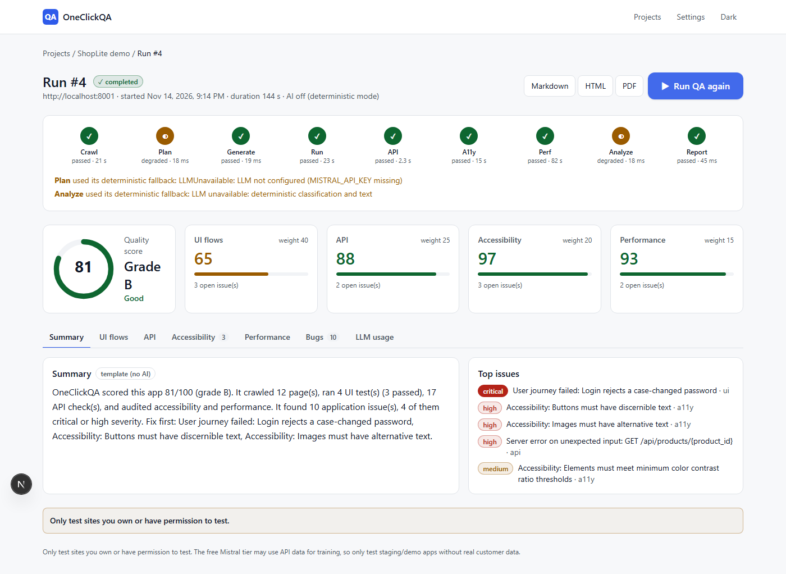

# OneClickQA

**One-click QA for small teams without a QA engineer.** Paste a URL (plus an optional
OpenAPI spec and test login) and press **Run QA**. OneClickQA then:

1. crawls the app (same-origin, up to 15 pages), building a site map of pages, forms and
   API calls;
2. plans the key user journeys with **Mistral AI**;
3. writes Playwright tests and runs them in a real Chromium, self-repairing broken scripts;
4. checks your API (from the OpenAPI spec, or from the API calls seen while crawling);
5. audits accessibility with axe-core (WCAG 2.x A/AA);
6. measures performance (TTFB, FCP, LCP, CLS; median of 3 cold loads);
7. classifies failures and writes a plain-English bug report with AI;
8. shows everything on one dashboard: a 0–100 quality score, per-category results, history
   and trends, and Markdown/HTML/PDF export.

**AI plans, writes code and explains. It never decides pass/fail.** Verdicts come from
Playwright assertions, axe-core, HTTP/JSON-schema checks and measured metrics, and the
score is deterministic (UI 40 · API 25 · Accessibility 20 · Performance 15).



> ⚠️ **Only test sites you own or have permission to test.** The free Mistral tier may use
> API data for training, so **only test staging/demo apps without real customer data.**
> Passwords and tokens are never sent to the AI.

---

## 2-minute quick start

### Option A: Docker
```bash
cp .env.example .env            # optionally paste your MISTRAL_API_KEY
docker compose up --build
```
Open http://localhost:3000 and create a project:
* **URL**: `http://demo-app:8001` (the bundled demo shop, reachable from the backend
  container)
* **OpenAPI spec URL**: `/openapi.json`
* **Login**: `demo@example.com` / `Demo-Pass-2024`

Tick the consent box, then press **Run QA**.

### Option B: local (Windows, macOS, Linux)
Requires Python 3.11+ and Node 20+.
```bash
python -m venv .venv
# Windows: .venv\Scripts\activate     macOS/Linux: source .venv/bin/activate
pip install -e "backend[dev]" -e demo-app
python -m playwright install chromium
(cd frontend && npm install)
cp .env.example .env            # optionally paste your MISTRAL_API_KEY

# start demo app (:8001) + backend (:8000) + dashboard (:3000)
powershell -ExecutionPolicy Bypass -File scripts/dev.ps1     # Windows
./scripts/dev.sh                                             # macOS/Linux
```
Open http://localhost:3000 and add a project with URL `http://localhost:8001`, the
OpenAPI spec `/openapi.json` and the login `demo@example.com` / `Demo-Pass-2024`. Then
press **Run QA** and watch the live progress (about 2–3 minutes).

The scripts set `ALLOW_LOCAL_TARGETS=true` so the local demo app can be tested.

## Getting a free Mistral API key
1. Sign up at **https://console.mistral.ai**.
2. Choose the free **Experiment** plan (no credit card).
3. Go to *API Keys*, then *Create new key*.
4. Put the key in `.env` as `MISTRAL_API_KEY=...` and restart the backend.

**Without a key, OneClickQA still works** in deterministic mode:
* baseline journeys and template tests (login positive and negative, form submission);
* rule-based classification;
* a template summary.

The stepper marks those stages as *degraded*.

## How free-tier limits are handled
The Mistral free tier allows roughly 1 request per second. Every LLM call goes through
`backend/app/llm/client.py`:

| Control | Default | Env |
|---|---|---|
| Process-wide token bucket | 1 request/s | `MISTRAL_RPS` |
| Tokens-per-minute window | 400k | `MISTRAL_TPM` |
| Retry on 429/5xx/timeouts: exponential backoff with full jitter, honours `Retry-After` | 5 attempts | `MISTRAL_MAX_RETRIES` |
| Per-run call budget | 60 | `MAX_LLM_CALLS_PER_RUN` |
| Per-day call budget | 500 | `MAX_LLM_CALLS_PER_DAY` |
| Prompt-hash response cache (SQLite) | always on | – |
| Passing-script cache per project and journey | always on | – |
| JSON mode + pydantic validation + one repair retry | always on | – |

* When the budget is exhausted, or the key is missing or invalid, stages fall back to
  deterministic output instead of failing.
* Prompts are compact: site-map summaries instead of HTML, truncated logs, at most 20
  issues per analyst call.
* A typical first run against the demo app uses about **7 calls**. A re-run of an
  unchanged site uses **0 calls**.
* Every call (stage, model, prompt hash, tokens, latency, cache hit) is shown in the run's
  **LLM usage** tab.

## Configuration
Everything is configured with environment variables. See [`.env.example`](.env.example).
The most important ones:

| Variable | Default | Purpose |
|---|---|---|
| `MISTRAL_API_KEY` | – | Enables AI planning, code generation, analysis and summaries |
| `MISTRAL_MODEL_PLANNER` | `mistral-large-latest` | Journey planning and failure analysis |
| `MISTRAL_MODEL_CODE` | `codestral-latest` | Playwright test generation and repair |
| `MISTRAL_MODEL_FAST` | `mistral-small-latest` | Executive summary |
| `MISTRAL_MODEL_VISION` | `mistral-large-latest` | Optional screenshot check (`ENABLE_VISION_CHECK=true`) |
| `OCQA_SECRET_KEY` | auto-generated | Fernet key encrypting stored credentials |
| `ALLOW_LOCAL_TARGETS` | `false` | Allow localhost/private IPs (dev and demo only) |
| `EXTRA_ALLOWED_DOMAINS` | – | Extra domains the crawler may visit |
| `DEFAULT_MAX_PAGES` / `DEFAULT_MAX_DEPTH` | 15 / 3 | Crawl limits |
| `REQUEST_DELAY_MS` | 250 | Politeness delay between requests |

Model names change over time. Check https://docs.mistral.ai/getting-started/models/ and
override them with the env vars. If your plan lacks Codestral, set
`MISTRAL_MODEL_CODE=mistral-large-latest`.

## Dashboard
* **Projects**: list projects, or create one with a URL, an optional OpenAPI spec, an
  optional login (stored encrypted), max pages, and the privacy consent.
* **Project**: a big Run QA button, the score-over-time chart, latest vs previous run
  ("3 new issues, 2 fixed"), and run history.
* **Run**: a live progress stepper (Server-Sent Events) with per-stage timing and AI-call
  counts, the overall score and four category cards, export (Markdown, HTML, PDF), and these
  tabs:

  | Tab | Contents |
  |---|---|
  | Summary | AI-written summary and the top 5 issues |
  | UI flows | Journeys, generated scripts, screenshots, trace and video |
  | API | Endpoint table |
  | Accessibility | Violations grouped by impact |
  | Performance | Charts and a metrics table |
  | Bugs | Filters; mark findings ignored or fixed |
  | LLM usage | Calls, tokens, cache hits, budget |

* Light and dark mode. The dashboard itself passes axe-core (WCAG A/AA) with no serious
  violations (`scripts/ui_smoke.py`).

REST API docs: http://localhost:8000/docs.

## Demo app and acceptance
`demo-app/` is **ShopLite**, a small FastAPI shop with 10 planted bugs (see
[`demo-app/EXPECTED_BUGS.md`](demo-app/EXPECTED_BUGS.md)):

* a login that accepts a case-changed password;
* an image without alt text;
* an unlabeled button;
* a low-contrast button;
* a 3 s page;
* a layout-shifting banner;
* an API 500 on `id=0`;
* a schema violation;
* a JavaScript error;
* a broken link.

```bash
python scripts/acceptance.py                 # real Mistral if MISTRAL_API_KEY is set, else deterministic
python scripts/acceptance.py --mode mock     # recorded Mistral fixtures (offline)
```

Latest results ([deterministic](docs/ACCEPTANCE-deterministic.md),
[mock](docs/ACCEPTANCE-mock.md)):

| Mode | Detected | False positives | LLM calls (run 1 / re-run) | Cache hits on re-run | Run time |
|---|---|---|---|---|---|
| deterministic (no key) | 10/10 | 0 | 0 / 0 | – | ~145 s |
| mocked Mistral (recorded) | 10/10 | 0 | 7 / 0 | 3 | ~160 s |

Run it with your own key to produce `docs/ACCEPTANCE.md` for the real API. The
`pytest -m e2e` test does the same and needs `OCQA_E2E=1` plus `MISTRAL_API_KEY`.

## Development
```bash
cd backend && ruff check . ../demo-app ../scripts && mypy app && pytest -q   # Mistral is mocked; real e2e skipped
cd frontend && npm run lint && npm run typecheck && npm test && npm run build
python scripts/ui_smoke.py    # drives the real dashboard, takes screenshots, runs axe on it
```
CI (`.github/workflows/ci.yml`) runs all of the above except the UI smoke script.

Docs: [Architecture](docs/ARCHITECTURE.md) · [Prompts](docs/PROMPTS.md) ·
[Security](docs/SECURITY.md) · [Assumptions](docs/ASSUMPTIONS.md) ·
[Progress](docs/PROGRESS.md)

## Limitations
* **Single process.** It uses an in-process worker and SQLite, and runs one at a time.
  That is fine for a team tool, but not horizontally scalable without swapping in a real
  queue and Postgres (the schema is portable).
* **Generic login.** It finds a form with a password field and fills the first
  user/email field. Multi-step, SSO, CAPTCHA and MFA logins are not supported.
* **Shallow crawl.** The crawl is limited (15 pages, depth 3). Single-page-app routes are
  discovered only through rendered `<a href>` links. Forms other than login are never
  submitted during the crawl (only by tests).
* **Safe API mode.** API checks are GET/HEAD only by default. Request bodies for
  POST/PUT are not generated.
* **Approximate performance.** Metrics come from a local headless Chromium with no
  throttling, so they are indicative, not field data. Lighthouse is not used.
* **Sandbox limits.** The sandbox combines a static allowlist, restricted builtins, a
  subprocess, a network guard and timeouts. Resource limits apply on Linux only. See
  [SECURITY.md](docs/SECURITY.md) for the residual risks.
* **Experimental vision check.** It is off by default. Its findings are labelled
  "AI-suggested, unverified".
* **Docker is verified in CI, not on the build machine.** The `docker` CI job runs
  `scripts/docker_smoke.sh` on GitHub's Linux runners. It does `docker compose up --build`,
  adds the demo app, runs QA end to end and downloads the report, and it passes. The build
  machine had no Docker, so the local setup was verified with `scripts/dev.ps1`.
